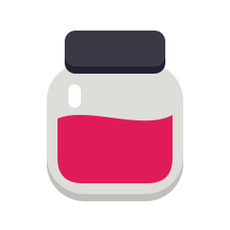
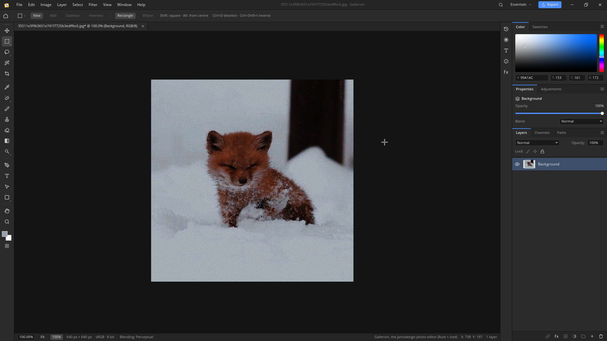
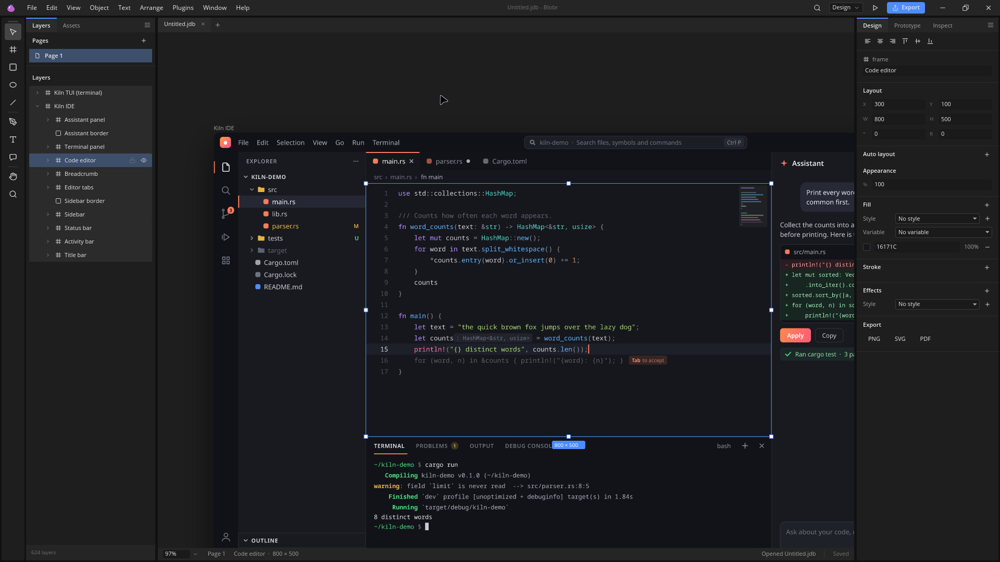

<div align="center">



# jamsdesign

**A Linux-first creative suite, written in Rust.**

Native apps for photo, video and interface design work, with the shortcuts and workflows you already know.

**[jamesisboredcoding.github.io/jamsdesign](https://jamesisboredcoding.github.io/jamsdesign)**


</div>

---

## The apps

<table>
  <tr>
    <td align="center" width="33%">
      <br>
      <h3>Photosplash</h3>
      <em>Photo editor</em>
    </td>
    <td align="center" width="33%">
      <br>
      <h3>Cinematica</h3>
      <em>Video editor</em>
    </td>
    <td align="center" width="33%">
      <br>
      <h3>Blobr</h3>
      <em>Interface and vector design</em>
    </td>
  </tr>
  <tr>
    <td valign="top">
      Layer-based raster editing with all 24 blend modes rendered on the GPU, pressure-sensitive
      brushes for pen tablets, selections, Free Transform, adjustments and filters with live
      preview, and its own <code>.jdp</code> document format. Photoshop-compatible shortcuts
      throughout.
    </td>
    <td valign="top">
      A timeline-based video editor inspired by Premiere, built on the same core, renderer and
      UI toolkit as Photosplash. In early development.
    </td>
    <td valign="top">
      A Figma-style design tool: frames, auto layout, components and variants, variables,
      live booleans, prototypes with smart animate, comments and code inspect, in
      <code>.jdb</code> files on your disk. AI agents can edit designs live through its MCP
      server.
    </td>
  </tr>
</table>

More apps will join the suite later.

## Screenshots

### Photosplash



### Blobr



## Highlights

- **Native and fast.** Pure Rust with a wgpu renderer; pixel work is tiled, copy-on-write and parallel.
- **Pen tablet support.** Pressure and tilt on Wayland, including KDE.
- **Familiar.** Tools, menus and shortcuts follow the industry-standard layout, so there is nothing new to learn.
- **Shared foundation.** Every app uses the same `jd-*` crates for colour, documents, GPU rendering and UI.
- **Agent friendly.** Blobr ships an MCP server so AI agents can build and edit designs, with every change an undo step.

## Getting started

You need a recent stable Rust toolchain (edition 2024) and a Linux desktop with a Vulkan-capable GPU.
Cinematica also needs the system FFmpeg development libraries.

Everything is one Cargo workspace, so run it all from the repository root:

```sh
cargo run -p photosplash -- path/to/photo.jpg
cargo run -p cinematica
cargo run -p blobr -- path/to/design.jdb

# Tests
cargo test --workspace
```

Each app has its own README with full details, shortcuts and status:
[Photosplash](photosplash/README.md) · [Cinematica](cinematica/README.md) · [Blobr](blobr/README.md)

## Repository layout

One git repository and one Cargo workspace (root `Cargo.toml`, `Cargo.lock`, `target/` and
`vendor/`):

```
jamsdesign/
├── crates/        shared jd-* crates
├── photosplash/   the photo editor (apps/photosplash, apps/tablet-spike)
├── cinematica/    the video editor (apps/cinematica)
├── blobr/         the design app (apps/blobr, apps/blobr-mcp), its roadmap and mockups
├── docs/          the website
└── img/           suite and app logos (SVG)
```

| Crate              | Purpose                                                                      |
| ------------------ | ---------------------------------------------------------------------------- |
| `jd-core`          | Colour maths (linear RGBA, sRGB, HSV), undo history, safe file writes.       |
| `jd-raster`        | Raster documents: layers, tiles, undo history, blend modes, brush engine.    |
| `jd-io`            | Image import and export, `.jdp` documents.                                   |
| `jd-gpu`           | wgpu renderer for compositing and blending.                                  |
| `jd-ui`            | iced theme tokens, icons, window chrome and shared widgets.                  |
| `jd-ai`            | On-device AI helpers (background removal).                                   |
| `jd-media`         | Video and audio probing, decoding and thumbnails via FFmpeg.                 |
| `jd-timeline`      | Sequences, tracks and clips with pure edit operations and undo.              |
| `jd-playback`      | Plays a sequence: mixes audio to the output and follows it with video.       |
| `jd-vector`        | Vector documents for Blobr: scene graph, auto layout, ops, undo, `.jdb`.     |
| `jd-vector-render` | Draws vector documents without a window: PNG, SVG and PDF export.            |
| `jd-figma`         | One-time import of Figma files into `.jdb` documents.                        |
| `jd-mcp`           | A small MCP server (stdio JSON-RPC) for the suite's apps.                    |

## Design

The suite's mockups live in [`blobr/mockups/suite.jdb`](blobr/mockups/README.md) and are edited
in Blobr; they were imported from Figma once. The app icons follow the GNOME / Adwaita style so
they sit naturally on a Linux desktop.

## Licence

jamsdesign is free software under the [GNU General Public License v3.0 or later](LICENSE).
`vendor/iced_winit` is a patched copy of iced's winit shell, under its own MIT licence.
